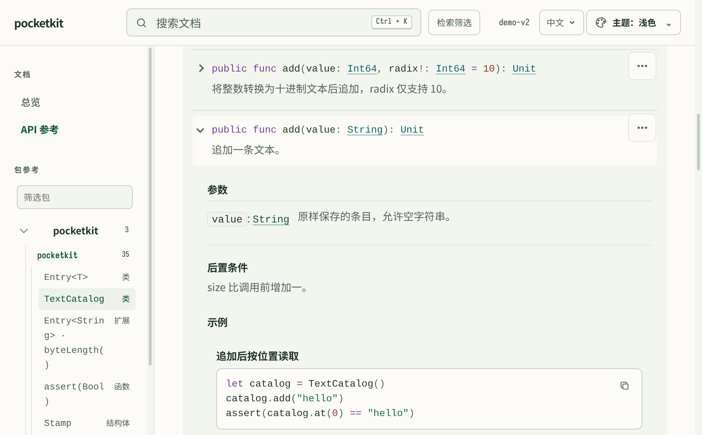

<h1 align="center">
  <picture>
    <source media="(prefers-color-scheme: dark)" srcset="docs/assets/brand/lockup-dark.svg">
    
  </picture>
</h1>

<p align="center"><strong>从源码注释，到可直接打开的仓颉 API 文档。</strong></p>

<p align="center">
<a href="https://github.com/lIlIIlIll/cjdoc/releases"></a>
<a href="https://github.com/lIlIIlIll/cjdoc/actions/workflows/ci.yml?query=branch%3Amain"></a>
<a href="https://github.com/lIlIIlIll/cjdoc/blob/main/LICENSE"></a>
<a href="docs/getting-started/install.md"></a>
</p>

[在线演示](https://liliilill.github.io/cjdoc/) · [快速开始](#快速开始) · [完整手册（当前源码）](docs/README.md)

<p align="center">
  <picture>
    <source media="(prefers-color-scheme: dark)" srcset="docs/assets/readme/preview-dark.png">
    
  </picture>
</p>

<p align="center">PocketKit 示例文档，由 cjdoc 实际生成 · <a href="https://liliilill.github.io/cjdoc/">在线演示</a></p>

## 快速开始

本 README 与手册描述**当前源码**。先按[安装步骤](docs/getting-started/install.md)准备 STS 1.2.0 SDK、匹配的静态 stdx，从同一提交构建并安装 `cjdoc`。运行时保留 SDK 环境。已发布版本与 main CI 徽章分别反映上游发行版、main 工作流，不代表本提交的完整验收。

工具已安装后，在一个空工作目录创建无依赖静态库：

```bash
cjpm init --name docdemo --path docdemo --type=static
cd docdemo
```

将 `cjpm.toml` 替换为：

```toml
[package]
name = "docdemo"
version = "0.1.0"
cjc-version = "1.2.0"
output-type = "static"

[dependencies]
```

新建完整 `src/api.cj`：

~~~cangjie
package docdemo

/**
 * 为名字生成问候语。
 *
 * name 原样保留，不修剪空白；空字符串返回 `Hello, !`。
 * @param name 要问候的名字，可以为空。
 * @return 格式为 `Hello, <name>!` 的字符串。
 * @example 问候仓颉 {must-pass run}
 * ```cangjie
 * println(greet("Cangjie"))
 * ```
 * ```output
 * Hello, Cangjie!
 * ```
 */
public func greet(name: String): String {
    return "Hello, ${name}!"
}
~~~

在 `docdemo/` 里编译并生成：

```bash
cjpm build
cjdoc generate --project . --format html
```

用浏览器打开 `target/doc/html/index.html`，进入 `docdemo` 包的 `greet`，即可阅读签名、参数、返回和示例。静态文件可直接打开，也可整站上传。默认生成不编译或运行注释示例；用 `cjdoc check --project . --check-examples` 核对示例的真实输出。逐步解释和平台打开方式见[第一份站点教程](docs/tutorials/first-site.md)。

## 按任务选择手册

| 你要做什么 | 从这里继续 |
|---|---|
| 加入项目首页、包概述和指南 | [连续教程](docs/tutorials/add-guides.md) |
| 发布作者维护的中英文译文 | [多语言教程](docs/tutorials/publish-languages.md) |
| 生成、检查、预览、发布 | [操作指南索引](docs/README.md#按任务操作) |
| 查 CLI、配置、标签、产物和查询协议 | [参考索引](docs/README.md#查规则) |
| 比较真实版本、连接依赖文档或接入 MCP | [独立进阶任务](docs/README.md#按任务操作) |

## 边界与排错

- 注释来自源码；cjdoc 不补写说明，不自动翻译，也不证明作者描述符合实现。默认受众选择不是隐私过滤。
- 普通 source 生成不编译项目；示例检查与可选 CHIR 使用真实编译器。CHIR 是保守语义补充，失败保留 AST/source fallback，不是 authoritative provider。
- 离线 `render` 只接受当前 Doc IR v18，不迁移旧输入。不同查询/索引协议有自己的版本。
- 发行包按清单 `sourceCommit` 查看同版本 README/手册；离线包不含预览图片，完整视觉预览请通过该提交在线查看。不要仅凭版本字符串套用当前手册。

遇到启动、项目根、输出所有权或外部工具问题，查[按症状排错](docs/how-to/troubleshoot.md)。项目开发、schema、发布与证据门禁见[维护者入口](https://github.com/lIlIIlIll/cjdoc/blob/main/docs/maintainer/README.md)。
