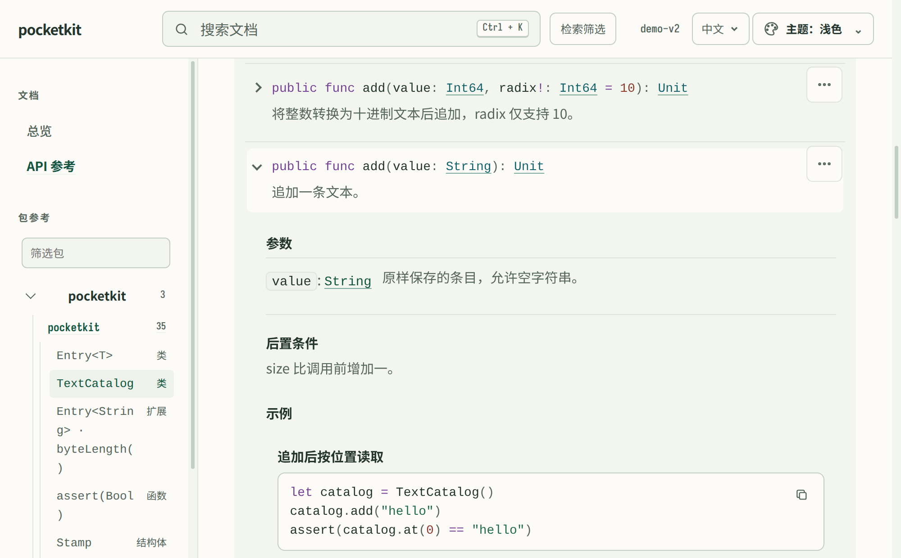

<h1 align="center">
  <picture>
    <source media="(prefers-color-scheme: dark)" srcset="docs/assets/brand/lockup-dark.svg">
    
  </picture>
</h1>

<p align="center"><strong>把仓颉源码里的文档注释生成为可搜索、可离线打开的 API 文档站点。</strong></p>

<p align="center">
<a href="https://github.com/lIlIIlIll/cjdoc/releases"></a>
<a href="https://github.com/lIlIIlIll/cjdoc/actions/workflows/ci.yml?query=branch%3Amain"></a>
<a href="https://github.com/lIlIIlIll/cjdoc/blob/main/LICENSE"></a>
<a href="docs/getting-started/install.md"></a>
</p>

<p align="center">
<a href="https://liliilill.github.io/cjdoc/">在线演示</a> · <a href="#安装">安装</a> · <a href="#快速开始">快速开始</a> · <a href="docs/README.md">用户手册</a> · <a href="docs/release-notes.md">发布记录</a>
</p>

<p align="center">
  <picture>
    <source media="(prefers-color-scheme: dark)" srcset="docs/assets/readme/preview-dark.png">
    
  </picture>
</p>

<p align="center">PocketKit 示例文档，由 cjdoc 生成</p>

## cjdoc 能做什么

cjdoc 读取 cjpm 项目的源码和 `/** ... */` 文档注释，输出 API 文档。注释写了什么，页面就显示什么：它不补写说明，也不自动翻译。

| 你想要 | cjdoc 提供 |
|---|---|
| 一个能直接阅读的 API 站点 | 静态 HTML：包、类型、成员导航，签名、参数、返回、异常和示例；内置搜索（`Ctrl+K`、`⌘K` 或 `/`）；双击 `index.html` 即可打开，也可整目录上传到任意静态托管 |
| 在 API 之外介绍项目 | 项目首页、包概述和 Markdown 指南，指南与 API 互相链接 |
| 中英文文档 | 发布作者维护的 `zh-CN` 与 `en` 内容，读者在页面上切换语言 |
| 确认文档可信 | `cjdoc check` 报告缺失或失效的注释，编译并运行注释里的示例，按覆盖率设置门槛 |
| 管理版本 | 比较两个版本的公开 API，把多个版本组合成可切换的站点 |
| 交给工具读取 | JSON（Doc IR）、Markdown、API surface、覆盖率和符号索引；`cjdoc query` 与本地 MCP 服务供编辑器和 Agent 查询 |

## 安装

cjdoc 运行在已加载 **Cangjie STS 1.2.0 SDK** 环境的终端里，支持 Linux x64、macOS ARM64 和 Windows x64。

- **预编译发行包**：从 [Releases](https://github.com/lIlIIlIll/cjdoc/releases) 下载对应平台的压缩包，核对校验值后按[安装指南](docs/getting-started/install.md#安装预编译发行包)安装。包含配套 worker 的版本须将两个可执行文件安装到同一目录。
- **从源码构建**：另需匹配的静态 stdx 1.2.0，步骤见[安装指南](docs/getting-started/install.md)。

安装后在任意目录确认：

```bash
cjdoc --version
```

输出 `cjdoc 0.7.8` 这样的版本行即可继续。

当前源码版默认使用与主程序一起安装的 CHIR worker 补充类型信息，不需要手填 worker 路径。已发布的 0.7.8 默认仍是源码模式；其用法以[对应版本手册](https://github.com/lIlIIlIll/cjdoc/blob/v0.7.8/docs/README.md)为准。

## 快速开始

为一个最小的仓颉库写注释，生成并打开它的 API 站点。

**前提条件**：`cjdoc --version`、`cjc -v` 和 `cjpm -v` 在当前终端都能运行。

**1. 创建项目。** 在一个空的工作目录执行：

```bash
cjpm init --name docdemo --path docdemo --type=static
cd docdemo
```

把 `cjpm.toml` 替换为：

```toml
[package]
name = "docdemo"
version = "0.1.0"
cjc-version = "1.2.0"
output-type = "static"

[dependencies]
```

**2. 写一个带注释的函数。** 新建 `src/api.cj`：

~~~cangjie
package docdemo

/**
 * 为名字生成问候语。
 *
 * name 原样保留，不修剪空白；空字符串返回 `Hello, !`。
 * @param name 要问候的名字，可以为空。
 * @return 格式为 `Hello, <name>!` 的字符串。
 * @example 问候仓颉 {must-pass run}
 * ```cangjie
 * println(greet("Cangjie"))
 * ```
 * ```output
 * Hello, Cangjie!
 * ```
 */
public func greet(name: String): String {
    return "Hello, ${name}!"
}
~~~

**3. 编译、检查示例并生成站点。** 在 `docdemo/` 里执行：

```bash
cjpm build
cjdoc check --project . --check-examples
cjdoc generate --project . --format html
```

**预期结果**

- `cjdoc check` 编译并运行注释里的示例，把实际输出与 `output` 围栏比较，全部一致时以退出码 `0` 结束。
- 站点入口是 `target/doc/html/index.html`。
- 终端报告的文档质量 warning 不代表示例或生成失败；按诊断检查对应注释。CHIR 无法补齐信息时仍保留源码声明。

用浏览器打开 `target/doc/html/index.html`，进入 `docdemo` 包的 `greet`，可以看到签名、参数、返回值和示例。整个 `target/doc/html/` 目录可以直接上传发布。

`generate` 默认会为 CHIR 语义补充编译项目，但不编译或运行注释里的示例；示例是否成立以 `check --check-examples` 的结果为准。每一步的解释和各平台的打开方式见[生成第一个站点](docs/tutorials/first-site.md)。

## 保存常用设置

在项目根的 `cjdoc.toml` 中保存重复使用的设置。例如，为上面的 `docdemo` 添加：

```toml
[output]
formats = ["html"]
directory = "target/doc"
```

以后在项目根执行 `cjdoc generate` 即可生成同样的站点。临时换目录时用 `cjdoc generate --output target/preview`；命令行值覆盖对应配置默认值。更多设置见[配置参考](docs/reference/configuration.md)。

## 接下来

| 你要做什么 | 从这里继续 |
|---|---|
| 加入项目首页、包概述和指南 | [加入首页和指南](docs/tutorials/add-guides.md) |
| 发布中英文文档 | [发布中英文](docs/tutorials/publish-languages.md) |
| 生成、检查、预览、发布、比较版本、接入 MCP | [按任务操作](docs/README.md#按任务操作) |
| 查命令选项、`cjdoc.toml`、注释标签、产物和查询协议 | [查规则](docs/README.md#查规则) |
| 命令报错或结果不符合预期 | [按症状排错](docs/how-to/troubleshoot.md) |

## 使用前需要知道

- 页面内容来自源码注释。发布前请[核对 API 说明与实际行为](docs/how-to/review-contracts.md)。
- 默认只呈现公开和受保护的 API。这个范围决定读者看到什么，不是脱敏手段；调整范围见[选择输入](docs/how-to/select-inputs.md)。
- 平台差异和资源上限见[状态与限制](docs/reference/states-and-limits.md)。

## 参与开发

修改 cjdoc、运行本地检查或准备发行版，从[维护者文档](https://github.com/lIlIIlIll/cjdoc/blob/main/docs/maintainer/README.md)开始。各版本的变化见[发布记录](docs/release-notes.md)。

## 许可证

[MIT](https://github.com/lIlIIlIll/cjdoc/blob/main/LICENSE)。随发行包分发的第三方组件见 [THIRD_PARTY_NOTICES.md](https://github.com/lIlIIlIll/cjdoc/blob/main/THIRD_PARTY_NOTICES.md)。
