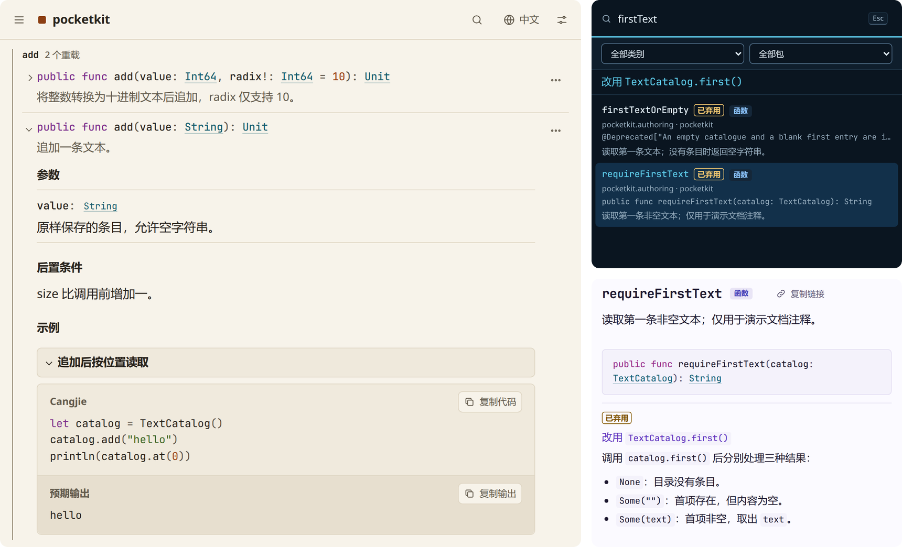

<h1 align="center">
  <picture>
    <source media="(prefers-color-scheme: dark)" srcset="docs/assets/brand/lockup-dark.svg">
    
  </picture>
</h1>

<p align="center"><strong>从仓颉源码和文档注释生成可搜索、可离线阅读的 API 站点。</strong></p>

<p align="center">
<a href="https://github.com/lIlIIlIll/cjdoc/releases"></a>
<a href="https://github.com/lIlIIlIll/cjdoc/actions/workflows/ci.yml?query=branch%3Amain"></a>
<a href="https://github.com/lIlIIlIll/cjdoc/blob/main/LICENSE"></a>
<a href="docs/getting-started/install.md"></a>
</p>

<p align="center">
<a href="https://liliilill.github.io/cjdoc/">在线演示</a> · <a href="#快速开始">快速开始</a> · <a href="#安装">安装</a> · <a href="docs/README.md">用户手册</a>
</p>

<p align="center">
  <a href="docs/assets/readme/preview-themes.webp">
    
  </a>
</p>

<p align="center">由当前源码版 cjdoc 生成的 PocketKit 文档，图中部分功能尚未进入发行包 · 点图查看原图</p>

## 安装

1. 在当前终端加载 [Cangjie STS 1.2.0 SDK](docs/getting-started/install.md#前提准备-sdk-120)，确认 `cjc -v` 和 `cjpm -v` 都报告 `1.2.0`。
2. 从 [v0.7.9 发布页](https://github.com/lIlIIlIll/cjdoc/releases/tag/v0.7.9)下载对应平台的压缩包（Linux x64、macOS ARM64 或 Windows x64），[校验后解压](docs/getting-started/install.md#安装预编译发行包)。不要只下载单独的可执行文件，归档才包含配套 worker。
3. 把 `cjdoc` 和 `chir-worker-main` 放在同一个目录（Windows 上两者都有 `.exe`），再把该目录加到当前终端的 `PATH`。
4. 运行 `cjdoc --version`。安装 v0.7.9 后应看到 `cjdoc 0.7.9`。

想体验截图中的新功能，可[从源码构建](docs/getting-started/install.md#从源码构建)。如果你是在发行归档里打开本文件，请按 `release-manifest.json` 的 `sourceCommit` 在 [GitHub 仓库](https://github.com/lIlIIlIll/cjdoc)查看同版本的 `docs/README.md`。

## 快速开始

进入已有 `cjpm` 项目的根目录。下面在一个已有的包里添加函数，不用改 `cjpm.toml`。还没有项目？跟着[第一个站点](docs/tutorials/first-site.md)从空目录开始。

### 1. 为一个 API 写注释

在包的源码目录新建 `greet.cj`。把第一行的 `package demo` 换成该目录其他源码文件的 `package` 声明。选一个没有定义同名函数的包。

~~~cangjie
package demo

/**
 * 为名字生成问候语。
 *
 * 名字里的空白原样保留，允许空字符串。
 *
 * @param name 要问候的名字。
 * @return 格式为 `Hello, <name>!` 的字符串。
 * @example 问候普通名字和空名字 {must-pass run}
 * ```cangjie
 * println(greet("Cangjie"))
 * println(greet(""))
 * ```
 * ```output
 * Hello, Cangjie!
 * Hello, !
 * ```
 */
public func greet(name: String): String {
    return "Hello, ${name}!"
}
~~~

cjdoc 从声明读取签名，从 `/** ... */` 注释读取说明和示例。`output` 中的两行是你写下的预期输出；生成站点并不会运行这段代码。说明和译文也不会自动补齐。

### 2. 生成并打开站点

在项目根目录运行：

```bash
cjdoc generate --project . --format html
```

打开 `target/doc/html/index.html`，在页眉搜索 `greet`。打开结果后，可看到签名、参数与返回值说明，以及示例代码和两行预期输出。如果项目配置了别的输出目录，从该目录的 `html/index.html` 打开。没配置输出格式时，省略 `--format html` 只会生成 JSON。

### 3. 边改边看

在项目根目录启动本地预览：

```bash
cjdoc serve --project .
```

用浏览器打开 `http://127.0.0.1:8080/`。改一下 `greet.cj` 的摘要并保存，等终端提示重建完成，再刷新 `greet` 页面，应看到新摘要。完成后按 `Ctrl+C` 停止预览。端口被占用或页面没更新时，见[本地预览指南](docs/how-to/preview.md)。

### 4. 检查示例输出

仅在信任项目中的示例代码、且当前环境能为示例进程施加内存限制时，在项目根目录运行：

```bash
cjdoc check --project . --check-examples
```

`{must-pass run}` 要求示例编译并运行成功，实际标准输出必须与 `output` 中的两行一致。命令检查整个项目，启用的检查都通过时以 `0` 退出。看到 `CJDOC3072` 时对照诊断中的预期和实际输出；看到 `CJDOC3074` 时，示例未能构建为可执行文件，或当前环境无法施加内存限制。处理方式见[示例检查指南](docs/how-to/check-examples.md)。

## 用文档完成什么

| 你的任务 | 从这里开始 |
|---|---|
| 给 API 站点加项目介绍、包概述或上手指南 | [加入首页和指南](docs/tutorials/add-guides.md) |
| 把生成的站点发给读者 | [生成与发布](docs/how-to/generate-and-publish.md) |
| 找漏写的说明，给 CI 加文档覆盖率门槛 | [检查质量](docs/how-to/check-quality.md) |
| 让读者在中文和英文之间切换 | [发布中英文](docs/tutorials/publish-languages.md) |
| 查升级会影响哪些 API，发布多个版本 | [比较 API 与发布版本](docs/how-to/compare-and-version.md) |
| 让编辑器或 Agent 查询已生成的文档 | [命令行查询与 MCP](docs/how-to/query-and-mcp.md) |

查命令、配置或注释标签，打开[用户手册](docs/README.md#查规则)。要导出 Markdown、JSON 或 API 报告，查[输出格式](docs/reference/artifacts.md)。扩大 API 展示范围或发布机器可读文件前，先[确认要公开的内容](docs/how-to/select-inputs.md)。

无法启动或生成结果不符合预期？见[按症状排错](docs/how-to/troubleshoot.md)。

## 参与开发

修改 cjdoc 请读[维护者文档](https://github.com/lIlIIlIll/cjdoc/blob/main/docs/maintainer/README.md)。升级请查[发布记录](https://github.com/lIlIIlIll/cjdoc/blob/main/docs/release-notes.md)。

## 许可证

[MIT](https://github.com/lIlIIlIll/cjdoc/blob/main/LICENSE)。随工具分发的组件见[第三方声明](https://github.com/lIlIIlIll/cjdoc/blob/main/THIRD_PARTY_NOTICES.md)。
